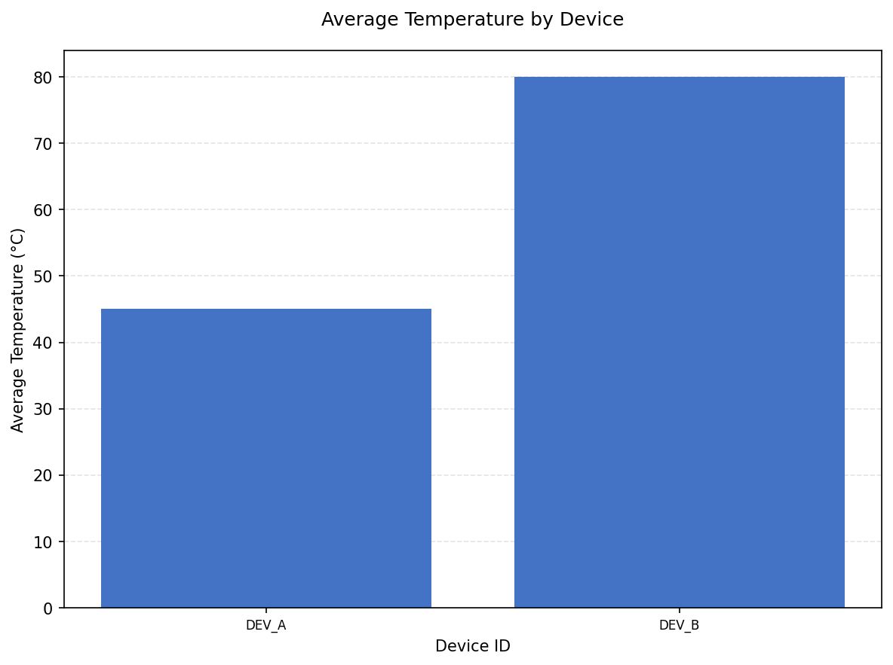

<div align="center">

# Device Log Summarizer

### Turn device telemetry into a clear, trustworthy summary.

Validate a CSV, compare each device's average temperature, export a JSON report, and chart the devices that meet the temperature threshold.

[](https://www.python.org/)
[](https://matplotlib.org/)
[](#test-it)
[](#assessment-status)

**[Quick start](#quick-start) · [See the chart](#chart-preview) · [Data rules](#data-rules) · [Run tests](#test-it) · [Assessment status](#assessment-status)**

</div>

---

## The workflow

```text
Telemetry CSV  ──▶  Validate & aggregate  ──▶  summary.json  ──▶  temperature_chart.png
                           │
                           └── Keep devices with mean temperature ≤ 80.0 °C
```

## What it does

| | Capability | What you get |
|---|---|---|
| 📄 | **CSV processing** | Required-column validation and clear handling of malformed or invalid records |
| 🌡️ | **Per-device summary** | Valid record count, arithmetic mean, and case-insensitive `ERROR` count |
| 🎯 | **Temperature filter** | Retains means at or below **80.0 °C**; excludes only values above it |
| 🧾 | **JSON report** | Reproducible device ordering, filter settings, and row-count metadata |
| 📊 | **Chart generation** | Labeled Matplotlib bar chart with spacing for long device names |
| 🧪 | **Automated checks** | 23 `unittest` cases for Sections 2 and 3 |

## Quick start

### 1. Install

Windows PowerShell:

```powershell
py -m venv .venv
.\.venv\Scripts\Activate.ps1
python -m pip install -r requirements.txt
```

No activation? Use the virtual environment's interpreter directly:

```powershell
.\.venv\Scripts\python.exe -m pip install -r requirements.txt
```

### 2. Process a CSV

Put the recruiter-provided file at the project root as `device_telemetry.csv`, or pass its path:

```powershell
python .\main.py --input "C:\path\to\device_telemetry.csv" --output .\summary.json
```

### 3. Create the chart

```powershell
python .\plot_results.py --input .\summary.json --output .\temperature_chart.png
```

The commands work from any current directory when you provide full input/output paths. Without options, each script uses its default files beside the script.

<details>
<summary><strong>▶ Try the included synthetic fixture</strong></summary>

The fixture is for local testing only; it is not a substitute for the assessment's official CSV.

```powershell
python .\main.py --input .\tests\fixtures\sample_device_telemetry.csv --output .\summary.json
python .\plot_results.py --input .\summary.json --output .\temperature_chart.png
```

Expected summary for this four-row fixture:

| Device | Valid records | Average (°C) | ERROR records | Result |
|---|---:|---:|---:|---|
| `DEV_A` | 2 | 45.00 | 1 | Retained |
| `DEV_B` | 1 | 80.00 | 0 | Retained at the boundary |
| `DEV_C` | 1 | 90.00 | 0 | Excluded |

There are 4 input rows, 4 valid rows, 0 rejected rows, and 1 excluded device.

</details>

## Chart preview

This preview is generated from the **synthetic fixture**, not from recruiter-provided data.

<div align="center">



*DEV_A and DEV_B are retained; DEV_C is excluded because its average is above 80.0 °C.*

</div>

## Jump to a detail

- [CSV format and data rules](#data-rules)
- [Outputs](#outputs)
- [Tests](#test-it)
- [Section 1 and assessment status](#assessment-status)
- [Project files](#project-map)
- [Limitations](#limitations)

## Data rules

The CSV requires the columns `device_id`, `status`, and `temperature`. Extra columns are ignored.

<details>
<summary><strong>CSV example and row validation</strong></summary>

```csv
device_id,status,temperature
DEVICE_1,OK,42.5
DEVICE_1,ERROR,45
```

- Surrounding whitespace is stripped from headers and values.
- A row is rejected if device ID, status, or temperature is blank; if it has missing or extra fields; or if temperature is not a finite number.
- Invalid temperatures are not turned into zero. `NaN` and infinities are rejected.
- A CSV with a missing file, missing header/required column, duplicate header, or malformed quoting fails without producing a report.
- `ERROR` matching is case-insensitive. Only valid rows contribute to device totals and ERROR counts.

</details>

<details>
<summary><strong>Aggregation, threshold, and count meanings</strong></summary>

- The average is the arithmetic mean of valid temperature readings.
- A device is retained when its mean is **less than or equal to 80.0 °C**. Exactly `80.0` is retained; anything strictly above is excluded.
- Devices are ordered lexicographically by ID to keep output deterministic.
- `total_input_rows` counts all parsed data rows. `valid_rows` and per-device `total_records` include only accepted records. `rejected_rows` counts rejected records. `excluded_devices` counts devices with a valid mean above the threshold.
- Devices without valid readings are not aggregated; no division by zero is performed.
- An empty CSV (header only) is reported differently from a non-empty dataset with no qualifying devices.

</details>

## Outputs

| File | Description |
|---|---|
| `summary.json` | Generation time, source path, filter, retained device summaries, and input/valid/rejected/excluded counts |
| `temperature_chart.png` | Bar chart comparing the retained devices' average temperatures |

The JSON is written as UTF-8 and replaced atomically. Errors go to stderr with a nonzero exit status; a failed command does not print a success message.

## Test it

Run the Section 2 and Section 3 tests:

```powershell
python -m unittest discover -s tests -v
```

The suite uses temporary CSV/JSON files and tests filtering boundaries, aggregation/counts, invalid data, CLI errors, JSON validation, and chart creation. It does not test Section 1. On macOS/Linux, use `python3 -m unittest discover -s tests -v`.

## Assessment status

> [!IMPORTANT]
> The official recruiter-provided `device_telemetry.csv` was **not available** in the workspace. The sample fixture, JSON report, and chart are synthetic illustrations. Official-data validation is still required.

Section 1 is explicitly reserved for independent candidate work. [sanitize.py](sanitize.py) is only a placeholder; its implementation and tests are intentionally not provided.

<details>
<summary><strong>Submission checklist</strong></summary>

- [ ] Obtain the official CSV and run the processor against that file.
- [ ] Review the official-data `summary.json` and confirm counts/threshold behavior.
- [ ] Generate and inspect `temperature_chart.png` from the official report.
- [ ] Independently implement and test Section 1.
- [ ] Run the Section 2/3 suite and include source, tests, docs, prompt log, requirements, and outputs.
- [ ] Do not submit synthetic results as if they came from official data.

</details>

## Project map

```text
main.py                          Section 2: CSV processor CLI
plot_results.py                  Section 3: JSON chart CLI
sanitize.py                      Section 1: independent-work placeholder
summary.json                     Synthetic illustrative output
temperature_chart.png            Synthetic illustrative chart
PROMPT_LOG.md                    Honest record of AI-assisted chart work
requirements.txt                 Matplotlib dependency
tests/
├── test_main.py                 Section 2 tests
├── test_plot_results.py         Section 3 tests
└── fixtures/
    └── sample_device_telemetry.csv   Synthetic test data only
```

## Limitations

- No official dataset was available for validation.
- The chart includes retained devices only; excluded devices are represented in summary metadata.
- Matplotlib is the only external dependency. CSV/JSON processing and tests use Python's standard library.
- The CLI does not create or modify an official input file.

---

<div align="center">

Made for the **Software Engineering Intern** technical assessment · Python · Matplotlib

[Back to top](#device-log-summarizer)

</div>
